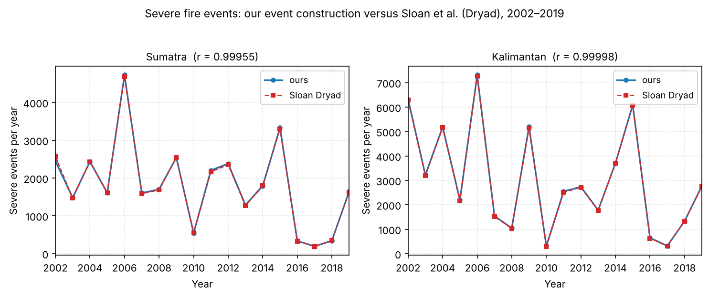
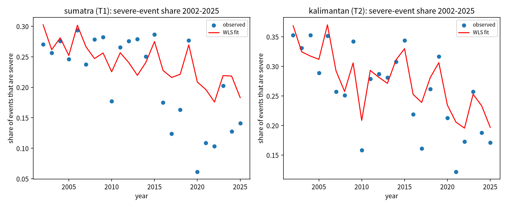
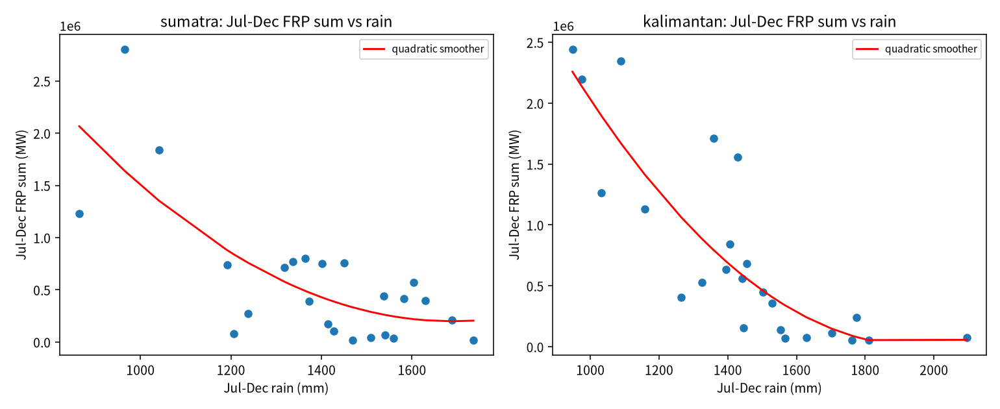

# Plan v2: conclusions (2 November 2026)

This note states what plan v2 found. The numbers come from the result notes and files below; nothing here is computed by hand.

- Plan: `docs/research_plan_v2.md` (frozen 2 Nov 2026; five clarifications in its Deviations section, fixed before any Step 1 result was seen)
- Q3: `docs/2026-11-02_v2_q3_results.md`, `results/v2_q3_results.csv`
- Step 0: `docs/2026-11-02_v2_step0_validation.md`, `results/v2_step0_comparison.csv`
- Step 1, T1 and T2, Holm, robustness, exploratory: `docs/2026-11-02_v2_results.md` and the `results/v2_step1_*`, `results/v2_t1t2_*`, `results/v2_holm.csv` and `results/v2_exploratory_*` files

## Answers to the three questions

### Q3. Do Sloan's two suggestions change the v1 result?

No. The rain and fire link holds when fire is measured by the sum of fire radiative power (FRP) and when rain is summed from two months before the season (24 seasons, 2002 to 2025):

| | Sumatra | Kalimantan |
|---|---|---|
| Aug–Oct FRP sum, per 1 mm/day less Aug–Oct rain | ×1.59 | ×1.47 |
| Aug–Oct detection count, same model and seasons | ×1.49 | ×1.43 |
| Aug–Oct FRP sum, per 100 mm less Jun–Oct rain | ×1.51 | ×1.36 |

The two islands' combined Aug–Oct FRP sum and Singapore's Aug–Oct mean PM2.5 have a Spearman correlation of 0.93 over 2016 to 2025 (10 seasons). With detection counts the figure was 0.88.

### Q1. Can Sloan et al. (2022) be reproduced on this data?

The fire events can. Our events, built with his definitions, match his published Dryad events inside our two island boxes: the yearly counts of severe events correlate at r = 0.9995 (Sumatra) and 0.99998 (Kalimantan), and our totals are within 1.5 percent of his.

His trend results reproduce in part. With his models on 2002 to 2019 (share of events that are severe, against Jul–Dec rain and a linear time trend):

| | Ours, change over 2002–2019 (95% bootstrap) | Sloan, range across his four regions |
|---|---|---|
| Severe share, Sumatra | −11.7% (−29.7 to −0.6) | −19 to −27% |
| Severe share, Kalimantan | −17.7% (−35.9 to −11.0) | −19 to −27% |
| Very severe share, Sumatra | +2.3% (−25.2 to +19.6) | −23 to −34% |
| Very severe share, Kalimantan | −30.1% (−59.1 to −12.8) | −23 to −34% |

Severe events fall on both islands, by less than he found. Very severe events fall in Kalimantan by an amount inside his range, but not in Sumatra, where our estimate is close to zero with a wide interval. The skewness of event severity falls on both islands (Sumatra −48.1%, Kalimantan −30.9%), but both intervals include zero. Our island boxes are not his province-based regions, and our events may run from December into January while his stop at the calendar year, so this is a side-by-side comparison, not a like-for-like one.

**Figure 1.** Severe fire events per year on our island boxes, 2002–2019, built with Sloan et al.'s event definitions, compared to his published Dryad counts. Pearson r for the severe-event series is 0.9995 on Sumatra and 0.99998 on Kalimantan. Source data: `results/v2_step0_yearly.csv` and `results/v2_step0_comparison.csv`. Generated by `src/v2_figures.py`.

### Q2. Does the decline continue to 2025?

Yes. Over 2002 to 2025, controlling for Jul–Dec rain, the share of fire events that are severe falls by 0.0038 a year in Sumatra (p = 0.0028) and 0.0041 a year in Kalimantan (p = 0.00004). On the fitted trend that is −22.5% and −21.5% over 17 years. All six confirmatory tests (T1 to T6) stay significant after the Holm correction. The decline keeps its sign with a 2016 step in place of the linear trend, with a three-year block bootstrap, when any single year is left out, and when events are rebuilt from Aqua detections only.

The decline is not even over time. The trend model's residuals average close to zero in 2002 to 2015 and are negative in 2016 to 2025 on both islands, so the observed share after 2016 sits below the straight line. With a 2016 step instead of a trend, the severe share is about 7 percentage points lower after 2016 in Sumatra and about 6 points lower in Kalimantan.

**Figure 2.** Fitted severe-event share for 2002–2025 from the T1/T2 weighted-least-squares model; the red line is the model's fitted value for each season using that season's actual Jul–Dec rain and the model's year and rain coefficients, and the dots are the observed severe-event share each season, on Sumatra and Kalimantan. Generated by `src/v2_stage2.py`. Source data: `results/v2_t1t2_yearly.csv`, `results/v2_t1t2_primary.csv`.

## What the results add up to

Two patterns hold across the 2002 to 2025 seasons.

1. Drier seasons have more fire. This holds for detection counts and for fire energy, for rain taken over the fire season or summed from June, and in the Singapore PM2.5 link.
2. For the same rain, fire since 2016 is lower, and a smaller share of fire events is severe. This agrees in direction with Sloan et al. (2022) and in timing with the v1 finding of a break around 2016. These data cannot say what caused the change.

The 2019 and 2023 seasons fit both patterns (exploratory): in GPCP, Jul–Dec 2023 was wetter than 2019 on both islands (Sumatra 1,238 against 865 mm; Kalimantan 1,325 against 1,033 mm), and its Jul–Dec FRP sum was lower (Sumatra 274,938 against 1,230,362 MW; Kalimantan 529,644 against 1,261,339 MW).

**Figure 3.** Exploratory scatter of Jul–Dec fire radiative power sum against Jul–Dec GPCP total rain, per island, 2002–2025, with quadratic and LOWESS smoothers. Both smoothers decline with rain and flatten at the high-rain end; no threshold test is performed. Generated by `src/v2_stage2.py`. Source data: `results/v2_t1t2_yearly.csv` (FRP and rain columns, as used by `src/v2_stage2.py`).

## Limits

- The evidence is correlational, from 24 seasons (10 for the Singapore link).
- The plan was written after the Aug–Oct counts and FRP totals had been seen, so it is not a pre-registration (see the plan's honesty statement).
- Rain comes from GPCP at 2.5 degrees, three cells per island. The CHIRPS check and the VIIRS check in the plan were not run.
- Rain enters the models linearly. A LOWESS curve of fire energy against Jul–Dec rain falls gradually and flattens at high rain, with no sharp threshold; no threshold test was run.
- Sumatra's very severe share is the one replication result that does not match Sloan's direction.

## Next steps

- Run the VIIRS check (needs the FIRMS key in the environment) and the CHIRPS check once a working download is found.
- Add the 2026 season when the MODIS standard product for it is published.
- Ask Sloan whether rebuilding his province-based regions would make the comparison more useful to him.
